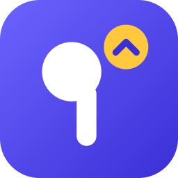

# BudsFirst

**Stop Android from moving your music and calls to every Bluetooth device that connects.**

You're on a call with your earbuds and walk back into your room. Your headphones are on the desk, paired with your laptop and your phone. They connect to the phone, and Android moves the call to them straight away. The same thing happens with YouTube and music.

BudsFirst lets you rank your devices. Media and calls always play on the highest one in the list that's connected. The others stay connected on standby, so moving the sound is instant, with no disconnecting or reconnecting.

## Features

- **A priority list.** Put your earbuds first and your headphones second. Headphones that connect while your earbuds are in can't take the sound.
- **Everything stays connected.** Only the output moves. Put your earbuds back in their case and the sound moves to the headphones at once.
- **Instant.** BudsFirst reacts to Android's Bluetooth events as they happen. It doesn't poll.
- **Media and calls are handled separately**, the way Android routes them.
- **Leaves other devices alone.** Your car or a speaker that isn't in the list behaves as usual.
- **Quick Settings tile** to turn the guard off for a while, for example to hand the sound to your headphones.
- **No internet permission.** About 2 MB.

## Requirements

- Android 12 or later. Tested on a POCO phone with HyperOS (Android 13), with OnePlus Nord Buds 2r and JBL Tune 770NC headphones.
- [Shizuku](https://shizuku.rikka.app/), which is free and doesn't need root. Android doesn't let normal apps choose where Bluetooth audio plays. Shizuku lets BudsFirst do it with the same rights as `adb shell`.

## Install

1. Install [Shizuku](https://shizuku.rikka.app/download/) and start it, either with *Wireless debugging* on the phone or with the `adb` command it shows you.
2. Download **BudsFirst.apk** from [Releases](https://github.com/saikiran9185/BudsFirst/releases/latest) and open it to install.
3. Open BudsFirst. Allow **Nearby devices**, then tap **Allow** for Shizuku.
4. Add your earbuds, then your headphones. The top device wins.

After a phone restart, start Shizuku again. BudsFirst starts by itself once Shizuku is running.

## Good to know

- **A short blip when a lower device connects.** Android makes a device it has just connected the active one before any app can step in. BudsFirst moves the sound back within a fraction of a second, so you may hear a short glitch. After that, both devices stay connected and nothing jumps.
- **Choosing the phone speaker still works.** If you pick *This phone* in the output switcher while your devices are connected, BudsFirst leaves that alone.
- **To use a lower device for a while,** move it up the list or turn the guard off with the tile.
- **LE Audio** devices aren't handled yet, only classic Bluetooth audio (A2DP for media and HFP for calls).

## How it works

The guard runs in a process that Shizuku starts as the shell user (uid 2000). That user holds `BLUETOOTH_PRIVILEGED`, which `BluetoothAdapter.setActiveDevice` requires. For media and for calls separately, the rule is:

- The device that should play is the highest one in the list that's connected.
- If a lower device in the list has the sound, move it back.
- If nothing has the sound because the device that was playing left, hand over at once.
- Devices outside the list, and the phone speaker chosen on purpose, are left alone.
- If something keeps taking the sound back (more than six switches in ten seconds), pause for 30 seconds instead of fighting it.

On Android 13, Bluetooth isn't built to run outside an app, so this needed three workarounds:

1. **`BluetoothAdapter` is null** in a process that isn't an app. The guard sets up `BluetoothFrameworkInitializer` with a `BluetoothServiceManager` itself.
2. **The A2DP profile binds a service**, and ActivityManager refuses `bindService` from callers that aren't apps. The guard's `Context` instead asks the BudsFirst app, through its `RelayProvider`, for the service's binder.
3. **Broadcasts are never delivered** to such a process. The app receives Android's Bluetooth broadcasts and pokes the guard over a binder. The guard also holds an external handle on the app's provider. Android treats that as a foreground dependency, so the app stays alive to forward events. If the link drops, the guard checks four times a second until it's back.

`core/` is the engine, plain Java with no dependencies. `app/` is the Jetpack Compose app, the Shizuku service and the relay.

## Build

You need JDK 17 and the Android SDK (platform 36, build-tools 36.1.0).

```sh
./gradlew assembleRelease
```

The engine also runs on its own from a computer, which is handy for testing. Install the app first, because the engine uses its relay:

```sh
core/build.sh
adb shell mkdir -p /data/local/tmp/budsfirst
adb push core/build/budsfirst.dex /data/local/tmp/budsfirst/
printf 'AA:BB:CC:DD:EE:01  # earbuds\nAA:BB:CC:DD:EE:02  # headphones\n' > priority
adb push priority /data/local/tmp/budsfirst/
adb shell 'cd /data/local/tmp/budsfirst && app_process -Djava.class.path=budsfirst.dex /system/bin dev.saikiran.budsfirst.Main list'
```

`list` shows paired devices and where media and calls play. `run` starts the guard in the foreground.

## License

[MIT](LICENSE)
